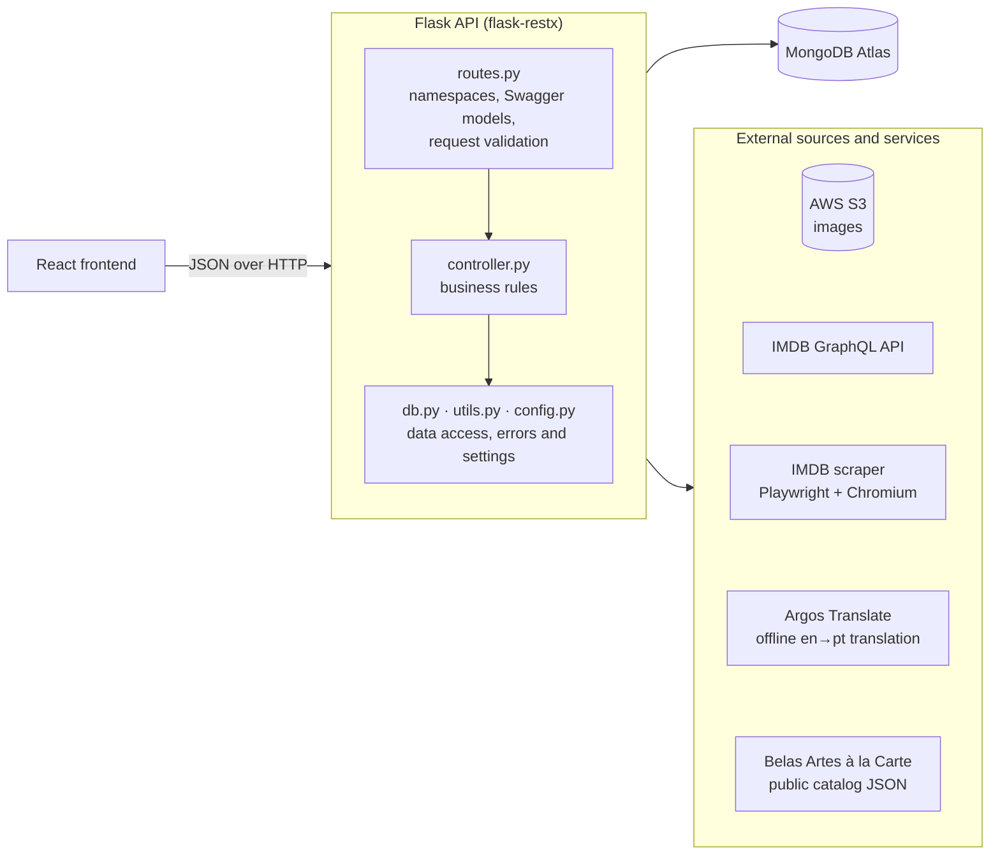

# Movie Search — backend

[](https://github.com/francisdiasbr/movie-search-backend/actions/workflows/ci.yml)

REST API behind **Movie Search**, a personal product for keeping track of films and series: a
favorites list enriched with IMDB data, authored reviews, keyword-based suggestions, still images
and a TV series list. It serves a React and TypeScript frontend that lives in a separate repository.

Built with **Python 3.11, Flask 3, flask-restx, MongoDB Atlas and AWS S3**.

> 🇧🇷 A versão principal deste documento está em português: [README.md](README.md)

## Contents

- [Architecture](#architecture)
- [API](#api)
- [Technical decisions](#technical-decisions)
- [Running locally](#running-locally)
- [Tests and CI](#tests-and-ci)
- [Project layout](#project-layout)

## Architecture



Each feature is a folder with the same two layers:

- **`routes.py`** declares the flask-restx namespace, the Swagger models and thin resource classes.
  No business logic lives here.
- **`controller.py`** holds the business rules and returns `(body, status)` tuples.

Everything the features share sits at the root: `config.py` (settings and the MongoDB connection),
`db.py` (data-access helpers) and `utils.py` (error responses, body parsing, sanitizing, image
optimization).

## API

Interactive documentation (Swagger UI) is served at `/docs`. All routes are under `/api`.

| Feature | Method and path | What it does |
|---|---|---|
| Favorites | `POST /favorites/search` | Paginated search with filters and a search term |
| | `GET /favorites/<tconst>` | One favorite; `?lang=pt` returns the Portuguese version |
| | `POST /favorites/<tconst>` | Adds a film, collecting its data from IMDB |
| | `PUT /favorites/<tconst>` | Edits a favorite (for example, marks it as watched) |
| | `DELETE /favorites/<tconst>` | Removes a favorite |
| | `POST /favorites/<tconst>/translate` | Generates the Portuguese translation of a favorite |
| Keywords | `GET /keywords` · `POST /keywords` | Lists and saves favorite keywords |
| | `DELETE /keywords/<keyword>` | Removes a keyword |
| | `POST /keywords/suggest-movies` | Suggests films for a set of keywords or director names |
| Reviews | `POST /write-review/search` | Paginated search of authored reviews |
| | `GET` · `POST` · `PUT` · `DELETE /write-review/<tconst>` | Reads, creates, edits and removes the review of a film |
| Images | `GET /main-images/<tconst>` | Lists the images of a film with their captions |
| | `POST /main-images/<tconst>` | Uploads an image to S3 |
| | `DELETE /main-images/<tconst>/<filename>` | Removes an image from S3 and its metadata |
| Series | `POST /series/search` | Lists the series, with search by title |
| | `GET` · `POST` · `PUT` · `DELETE /series/<tconst>` | Reads, adds, marks as watched and removes a TV series |
| Belas Artes | `GET /belas-artes/recent` | Recently added films of a streaming catalog, with their IMDB rating |

`tconst` is the IMDB identifier of a title, such as `tt0053198`.

Routes that take a body require JSON (`Content-Type: application/json`): without it they answer
`415`, and with malformed JSON or a body that fails the model, `400`.

## Technical decisions

**One error convention, enforced in one place.** A duplicate resource is `409`, a missing one is
`404`, and a dependency that is down is `503`. MongoDB, S3 and the IMDB scraper each raise their own
exception (`DatabaseUnavailable`, `StorageUnavailable`, `IMDBUnavailable`), and `app.py` turns the
three into `503 { "message": ... }`. Controllers never check for a missing connection, and a blocked
scraper is never mistaken for a film that does not exist.

**Dependencies fail per route, not at boot.** The MongoDB connection is only opened on the first
request, so the process starts without it and the routes answer `503`. Without the AWS keys the image
routes answer `503`; without the RapidAPI or OpenSubtitles keys a favorite is saved without
`magnet_link` or `subtitle_url`.

**A shared data-access layer.** Controllers go through `db.py` (`insert`, a paginated `search`,
`update`, `delete`, `serialize`) instead of calling pymongo in different ways. Client filters are
sanitized before they reach `find`.

**GraphQL first, scraping only where needed.** Suggestions, ratings, series and banners come from
IMDB's GraphQL API, which needs no session. The fields that API does not expose are read by a
scraper: a single Chromium driven by Playwright in a dedicated thread, because the sync API is not
thread-safe and the persistent browser profile can only be opened once. Requests are rate-limited,
pages are cached for ten minutes, and blocked attempts are retried before the API gives up with a
`503`.

**Offline translation.** Favorites are stored in English, as IMDB provides them, plus a Portuguese
version generated by Argos Translate on the server, with no API key or per-request cost. The client
picks the language with `?lang=pt`.

**Images are optimized before upload.** Pillow resizes and compresses each image before it goes to
S3. Objects are named by a sequential id per film, and the captions are stored both as S3 object
tags and as metadata in MongoDB.

## Running locally

```bash
python -m venv venv
source venv/bin/activate
pip install -r requirements.txt
./venv/bin/playwright install chromium   # only needed by the IMDB scraper

cp .env.example .env                     # fill in the MongoDB Atlas connection string
python app.py                            # http://localhost:5000, Swagger at /docs
```

In-depth documentation (architecture, every feature route by route, data model, integrations and
tests) lives in [`docs/`](docs/README.md), in Portuguese.

The scraper keeps a browser session with IMDB. Renewing that session and the day-to-day operation
are covered in the [Portuguese README](README.md#sessão-do-imdb).

## Tests and CI

```bash
pip install -r requirements-dev.txt      # pytest, mongomock and Black
python -m pytest
python -m black --check .
```

The suite runs offline in a few seconds. MongoDB is simulated in memory with mongomock, so the
controllers run their real queries, and S3 and IMDB are replaced by mocks. It covers `utils.py`,
`db.py`, every controller and, through Flask's test client, the routes and the `503` responses.

GitHub Actions runs the formatting check and the suite on every push and pull request
([`ci.yml`](.github/workflows/ci.yml)).

## Project layout

```
app.py              Flask app, Swagger setup, blueprints and the 503 handlers
config.py           settings and the MongoDB connection
db.py               data-access helpers shared by every controller
utils.py            error responses, body parsing, sanitizing, image optimization
favorites/          favorites, IMDB scraper, translation, third-party lookups
keywords/           favorite keywords, film suggestions, IMDB GraphQL client
write_review/       authored reviews
main_images/        image upload, listing and removal on S3
series/             TV series list
belas_artes/        streaming catalog with IMDB ratings
tests/              one test file per module
```
