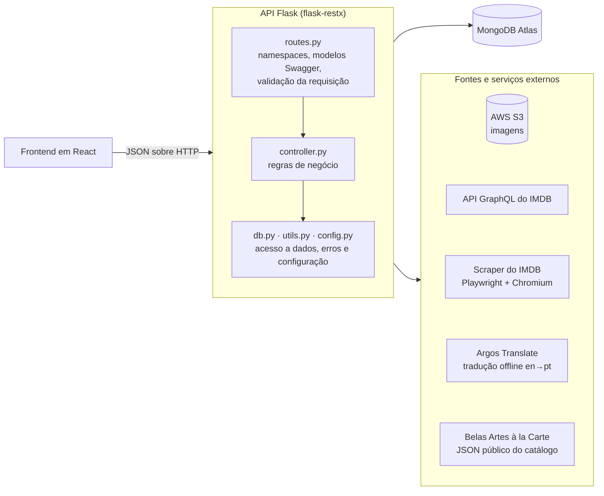

# Movie Search — backend

[](https://github.com/francisdiasbr/movie-search-backend/actions/workflows/ci.yml)

API REST por trás do **Movie Search**, um produto pessoal para acompanhar filmes e séries: lista de
favoritos enriquecida com dados do IMDB, resenhas autorais, sugestões por palavras-chave, imagens de
cena e lista de séries de TV. Atende um frontend em React e TypeScript, que fica em outro repositório.

Construída com **Python 3.11, Flask 3, flask-restx, MongoDB Atlas e AWS S3**.

> 🇺🇸 English version: [README.en.md](README.en.md)

## Índice

- [Arquitetura](#arquitetura)
- [API](#api)
- [Decisões técnicas](#decisões-técnicas)
- [Instalação e Configuração](#instalação-e-configuração)
- [Rodando o Projeto](#rodando-o-projeto)
- [Sessão do IMDB](#sessão-do-imdb)
- [Tradução para português](#tradução-para-português)
- [Sugestão por palavras-chave](#sugestão-por-palavras-chave)
- [Belas Artes à la Carte](#belas-artes-à-la-carte)
- [Séries](#séries)
- [Testes](#testes)
- [Scripts de Automação](#scripts-de-automação)
- [Documentação da API](#documentação-da-api)
- [Estrutura de pastas](#estrutura-de-pastas)

## Arquitetura



Cada feature é uma pasta com as mesmas duas camadas:

- **`routes.py`** declara o namespace do flask-restx, os modelos Swagger e classes de recurso enxutas.
  Nenhuma regra de negócio fica aqui.
- **`controller.py`** concentra as regras de negócio e devolve tuplas `(corpo, status)`.

O que as features compartilham fica na raiz: `config.py` (configuração e a conexão com o MongoDB),
`db.py` (helpers de acesso a dados) e `utils.py` (respostas de erro, leitura do corpo, sanitização e
otimização de imagens).

## API

A documentação interativa (Swagger UI) é servida em `/docs`. Todas as rotas ficam sob `/api`.

| Feature | Método e caminho | O que faz |
|---|---|---|
| Favoritos | `POST /favorites/search` | Busca paginada, com filtros e termo de busca |
| | `GET /favorites/<tconst>` | Um favorito; `?lang=pt` devolve a versão em português |
| | `POST /favorites/<tconst>` | Adiciona um filme, coletando os dados no IMDB |
| | `PUT /favorites/<tconst>` | Edita um favorito (por exemplo, marca como assistido) |
| | `DELETE /favorites/<tconst>` | Remove um favorito |
| | `POST /favorites/<tconst>/translate` | Gera a tradução de um favorito para o português |
| Palavras-chave | `GET /keywords` · `POST /keywords` | Lista e salva palavras-chave favoritas |
| | `DELETE /keywords/<keyword>` | Remove uma palavra-chave |
| | `POST /keywords/suggest-movies` | Sugere filmes a partir de palavras-chave ou nomes de diretores |
| Resenhas | `POST /write-review/search` | Busca paginada das resenhas autorais |
| | `GET` · `POST` · `PUT` · `DELETE /write-review/<tconst>` | Lê, cria, edita e remove a resenha de um filme |
| Imagens | `GET /main-images/<tconst>` | Lista as imagens de um filme, com as legendas |
| | `POST /main-images/<tconst>` | Envia uma imagem para o S3 |
| | `DELETE /main-images/<tconst>/<filename>` | Remove uma imagem do S3 e o metadado |
| Séries | `POST /series/search` | Lista as séries, com busca por título |
| | `GET` · `POST` · `PUT` · `DELETE /series/<tconst>` | Lê, adiciona, marca como assistida e remove uma série |
| Belas Artes | `GET /belas-artes/recent` | Filmes adicionados recentemente a um catálogo de streaming, com a nota do IMDB |

`tconst` é o identificador de um título no IMDB, como `tt0053198`.

As rotas que recebem corpo exigem JSON (`Content-Type: application/json`): sem ele respondem `415`,
e com JSON malformado ou fora do modelo, `400`.

## Decisões técnicas

**Uma convenção de erros, aplicada num lugar só.** Recurso duplicado é `409`, recurso ausente é
`404` e dependência fora do ar é `503`. MongoDB, S3 e o scraper do IMDB levantam cada um a sua
exceção (`DatabaseUnavailable`, `StorageUnavailable`, `IMDBUnavailable`), e o `app.py` transforma as
três em `503 { "message": ... }`. Os controllers nunca checam se a conexão existe, e um scraper
bloqueado nunca é confundido com um filme que não existe.

**Dependências opcionais falham por rota, não na inicialização.** Só o MongoDB Atlas é necessário
para a API subir. As chaves da AWS e de terceiros são validadas pelas rotas que as usam, que
respondem `503` quando faltam.

**Camada de acesso a dados compartilhada.** Os controllers passam pelo `db.py` (`insert`, `search`
paginado, `update`, `delete`, `serialize`) em vez de chamar o pymongo cada um de um jeito. Os filtros
enviados pelo cliente são sanitizados antes de chegar ao `find`.

**GraphQL primeiro, scraping só onde é preciso.** Sugestões, notas, séries e banners vêm da API
GraphQL do IMDB, que não exige sessão. Os campos que essa API não expõe são lidos por um scraper: um
único Chromium controlado pelo Playwright numa thread dedicada, porque a API síncrona não é
thread-safe e o perfil persistente do navegador só pode ser aberto uma vez. As requisições têm limite
de taxa, as páginas ficam em cache por dez minutos e as tentativas bloqueadas são refeitas antes de a
API desistir com um `503`.

**Tradução offline.** Os favoritos são gravados em inglês, como o IMDB entrega, mais uma versão em
português gerada pelo Argos Translate no servidor, sem chave de API nem custo por requisição. O
cliente escolhe o idioma com `?lang=pt`.

**Imagens otimizadas antes do envio.** O Pillow redimensiona e comprime cada imagem antes de ela ir
para o S3. Os objetos são nomeados por um id sequencial por filme, e as legendas ficam tanto em tags
do objeto no S3 quanto em metadados no MongoDB.

## Instalação e Configuração

### 1. Configuração do Ambiente

```bash
python -m venv venv
source venv/bin/activate  # No Windows: venv\Scripts\activate
pip install -r requirements.txt
```


### 2. Navegador do Playwright

O scraper do IMDB usa Playwright, que precisa do binário do Chromium baixado
separadamente do pacote Python:

```bash
./venv/bin/playwright install chromium
```

> ⚠️ Cada versão do Playwright exige uma revisão específica do Chromium. Se o
> scraper parar de funcionar com `Executable doesn't exist`, rode o comando
> acima de novo. A versão está fixada no `requirements.txt` justamente para
> evitar que isso aconteça sozinho num `pip install`.

### 3. Variáveis de Ambiente

Crie um arquivo `.env` na raiz do projeto a partir do modelo em `.env.example`. Só o MongoDB Atlas é obrigatório para a API subir; as chaves de AWS, RapidAPI e OpenSubtitles são exigidas apenas pelas rotas que as usam, que respondem `503` quando faltam.


## Rodando o Projeto

**Opção 1 - Com verificação da sessão do IMDB (recomendado):**
```bash
./verify_imdb.sh
```
Testa a sessão do IMDB, renova se necessário e sobe o servidor. Veja
[Sessão do IMDB](#sessão-do-imdb).

**Opção 2 - Direto:**
```bash
python app.py
```

A API estará disponível em `http://localhost:5000`


## Sessão do IMDB

O cadastro de um filme raspa dados do IMDB, que fica atrás do **AWS WAF**. O
scraper mantém um perfil do Chromium em `~/.cache/movie-search/imdb-profile`
com o token de verificação, reaproveitado entre execuções.

**Sintoma de sessão bloqueada:** ao adicionar um filme que existe, a API
responde `404` com *"Título do filme não encontrado no IMDB"*, e o log mostra:

```
ERROR favorites.scrapper: ... blocked by IMDB's AWS WAF after 3 attempts.
Run 'python imdb_verify.py' to renew the session.
```

**Como resolver:**

```bash
./verify_imdb.sh
```

O script para o backend, testa a sessão e — só se estiver bloqueada — abre uma
janela do navegador para você resolver a verificação manualmente. Depois sobe o
backend de novo. É o mesmo comando para o dia a dia e para quando dá problema.

Se quiser só a janela de verificação, sem mexer no servidor:
`python imdb_verify.py`.

> ⚠️ O Chromium tranca o diretório de perfil: o backend **precisa estar parado**
> enquanto a verificação acontece. O script cuida disso — rodar o
> `imdb_verify.py` na mão com o servidor no ar falha com erro de perfil em uso.

Na maior parte do tempo nada disso é necessário: o token vale dias, e desafios
pontuais do WAF são reprocessados automaticamente pelo próprio scraper antes de
ele desistir.


## Tradução para português

Os textos vindos do IMDB (sinopse, trivia, citações, gêneros e palavras-chave)
são traduzidos pelo [Argos Translate](https://github.com/argosopentech/argos-translate),
um tradutor automático que roda offline no servidor: sem chave de API nem custo.
O modelo en→pt (~100 MB) é baixado uma vez para `~/.local/share/argos-translate`.

- A tradução é feita ao cadastrar o favorito e gravada em `translations.pt`.
  Favoritos antigos: `POST /api/favorites/<tconst>/translate`.
- `GET /api/favorites/<tconst>?lang=pt` devolve os textos em português; o
  campo `lang` da resposta diz o idioma entregue. Sem o parâmetro vem o inglês.

## Sugestão por palavras-chave

`POST /api/keywords/suggest-movies` busca os filmes que o IMDB associa a cada
palavra-chave usando a API GraphQL do próprio IMDB (a mesma da busca avançada
do site). Não precisa de sessão, chave nem do scraper, e fica fora do WAF. Um
filme que casa com várias palavras-chave aparece antes de um que casa com uma
só; no empate vale a popularidade do IMDB. Palavras-chave viram o identificador
do IMDB automaticamente (`French New Wave` → `french-new-wave`); nomes de
pessoas não são palavras-chave e voltam vazios.

## Belas Artes à la Carte

`GET /api/belas-artes/recent` lista os filmes da seção *Adicionados
recentemente* do [Belas Artes à la Carte](https://www.belasartesalacarte.com.br/#/filmes)
com a nota do IMDB. Não há scraping de HTML: o site baixa o catálogo inteiro de
um JSON público (sem login nem chave), que o backend só baixa de novo quando a
versão muda. A nota vem da API GraphQL do IMDB, buscando pelo título original +
ano; só conta um título igual (ignorando acentos, pontuação e caixa) com ano até
±1, e fica em cache por 24 h. Sem correspondência, `imdb_rating` é `null`.

## Séries

`POST /api/series/<tconst>` adiciona uma série de TV à lista (`GET`, `PUT` com
`watched` e `DELETE` no mesmo caminho; `POST /api/series/search` lista com
busca por título). Tudo vem da API GraphQL do IMDb: título original e
brasileiro, anos, sinopse, gêneros, pôster, nota, temporadas, episódios,
criadores e elenco. Não há scraper nem sessão envolvida. Um tconst que não é
série (filme, episódio) responde `400`.

## Testes

```bash
pip install -r requirements-dev.txt   # pytest, mongomock e Black
python -m pytest
python -m black --check .
```

O GitHub Actions roda a formatação e a suíte a cada push e pull request
(`.github/workflows/ci.yml`).

A suíte roda offline em poucos segundos: o MongoDB é simulado em memória com
mongomock, e o S3 e o IMDB são substituídos por mocks. Cobre `utils.py`,
`db.py`, os controllers de cada feature e, pelo cliente de teste do Flask, as
rotas e as respostas `503` de dependência fora do ar.

## Scripts de Automação

O projeto inclui scripts para facilitar o desenvolvimento:

- **`./verify_imdb.sh`**: Testa a sessão do IMDB, renova se necessário e sobe o servidor
- **`python imdb_verify.py`**: Só a janela de verificação manual, sem mexer no servidor

## Documentação da API

A documentação interativa da API está disponível através do Swagger UI:

- **URL**: `http://localhost:5000/docs`
- Interface interativa para testar endpoints
- Documentação detalhada dos parâmetros e respostas

## Estrutura de pastas

```
app.py              app Flask, configuração do Swagger, blueprints e os handlers de 503
config.py           configuração e a conexão com o MongoDB
db.py               helpers de acesso a dados usados por todos os controllers
utils.py            respostas de erro, leitura do corpo, sanitização, otimização de imagens
favorites/          favoritos, scraper do IMDB, tradução, consultas a terceiros
keywords/           palavras-chave favoritas, sugestão de filmes, cliente GraphQL do IMDB
write_review/       resenhas autorais
main_images/        envio, listagem e remoção de imagens no S3
series/             lista de séries de TV
belas_artes/        catálogo de streaming com as notas do IMDB
tests/              um arquivo de teste por módulo
```
