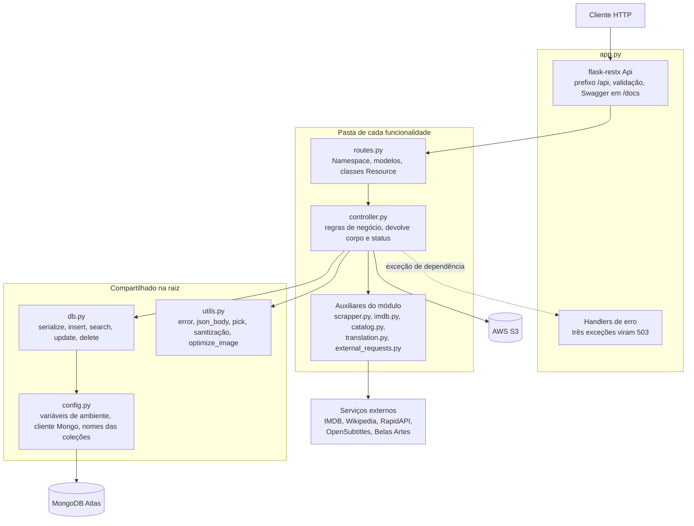
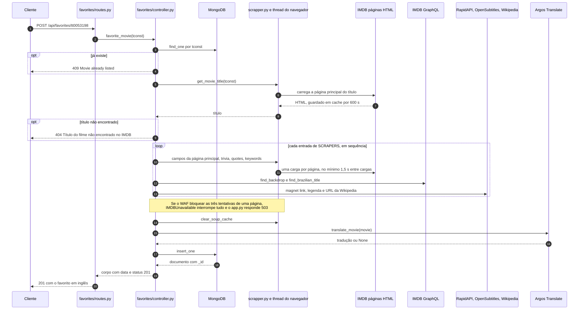
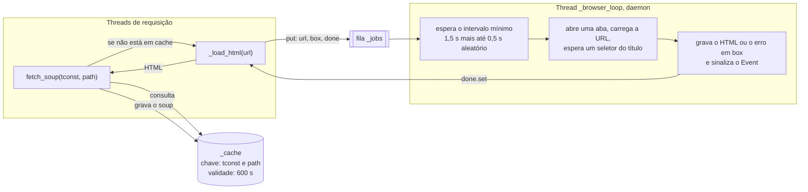

# Arquitetura

## Visão geral

O backend é uma aplicação Flask 3 com flask-restx. O flask-restx fornece os namespaces, a validação do corpo das requisições e a documentação Swagger. Os dados ficam no MongoDB Atlas, acessado com pymongo. As imagens ficam no AWS S3.

O código é organizado por funcionalidade. Cada pasta (`favorites/`, `keywords/`, `write_review/`, `main_images/`, `series/`, `belas_artes/`) tem as mesmas duas camadas, e a raiz guarda o que todas compartilham.

### Responsabilidade de cada camada

| Camada | Arquivo | O que faz | O que não faz |
|---|---|---|---|
| Rotas | `<módulo>/routes.py` | Declara o `Namespace`, os modelos Swagger e as classes `Resource`. Lê o corpo com `utils.json_body()` e os parâmetros de caminho e de query, e chama o controller. | Não tem regra de negócio. As únicas checagens feitas nas rotas são a presença do arquivo em `POST /main-images/<tconst>` e a forma da lista em `POST /keywords/suggest-movies`. |
| Controller | `<módulo>/controller.py` | Aplica as regras de negócio e devolve uma tupla `(corpo, status)`. | Não envolve as chamadas ao Mongo em `try/except`. Só as chamadas a serviços externos tratam os próprios erros. |
| Auxiliares | `favorites/scrapper.py`, `favorites/translation.py`, `favorites/external_requests.py`, `keywords/imdb.py`, `belas_artes/catalog.py` | Falam com um serviço externo e devolvem dados já no formato que o controller usa. | Não acessam o banco. |
| Acesso a dados | `db.py` | Cinco funções usadas por todos os controllers: `serialize`, `insert`, `search`, `update`, `delete`. | Não conhece nomes de coleção nem regras de negócio. |
| Configuração | `config.py` | Carrega o `.env`, expõe as configurações, os nomes das coleções e `get_mongo_collection(name)`. | |
| Utilidades | `utils.py` | `error`, `json_body`, `pick`, `sanitize_movie_data`, `sanitize_filters`, `optimize_image`. | |

O módulo `keywords/imdb.py` é o cliente GraphQL do IMDB e é usado por quatro controllers: `keywords`, `favorites` (`find_backdrop`, `find_brazilian_title`), `series` (`find_series`, `find_brazilian_title`) e `belas_artes` (`find_rating`).

## Inicialização do app

`app.py` é o ponto de entrada. A ordem do que acontece ao importá-lo:

1. `logging.basicConfig` é chamado antes dos demais imports, com o nível em `LOG_LEVEL` (padrão `INFO`) e o formato `%(asctime)s %(levelname)s %(name)s: %(message)s`. Sem isso o logger raiz ficaria em `WARNING` e as chamadas `logger.info` seriam descartadas.
2. Os imports dos módulos carregam `config.py`, que chama `load_dotenv()` e lê as variáveis de ambiente. Nenhuma conexão é aberta nesse momento.
3. A instância `Flask` é criada com `strict_slashes = False`, de modo que `/api/keywords` e `/api/keywords/` chegam ao mesmo recurso.
4. O `CORS` é configurado para todos os caminhos: origem `*`, métodos `GET`, `POST`, `PUT`, `DELETE`, `OPTIONS`, `HEAD`, cabeçalhos `Content-Type` e `Authorization` (entre outros) e `supports_credentials=True`.
5. O objeto `Api` do flask-restx é criado com `prefix="/api"`, `doc="/docs"`, `validate=True` e `catch_all_404s=True`.
6. Os três handlers de erro são registrados (veja [Tratamento de erros](#tratamento-de-erros)).
7. Duas rotas simples do Flask são declaradas fora do flask-restx: `GET /` e `GET /routes`.
8. Cada blueprint é registrado com `app.register_blueprint` e cada namespace com `api.add_namespace`. Os blueprints não têm rotas próprias: servem de suporte para o atributo `.api`, que guarda o `Namespace` do módulo. As rotas reais vêm dos namespaces.

Quando o arquivo é executado diretamente (`python app.py`), o servidor de desenvolvimento do Flask sobe em `0.0.0.0:5000` com `debug=False`.

O `requirements.txt` inclui o `gunicorn`, mas o repositório não tem arquivo que o configure (não há `Procfile` e o `runtime.txt` está vazio).

### O que é carregado sob demanda

Nada do que depende de rede é aberto na inicialização:

| Recurso | Quando é criado | Onde |
|---|---|---|
| Cliente do MongoDB | Na primeira chamada a `get_mongo_collection`. Fica guardado em `_mongo_client` e é reutilizado. | `config.get_mongo_client` |
| Cliente do S3 | A cada chamada de `s3_client()`. | `main_images/controller.py` |
| Thread do navegador (Playwright) | Na primeira página do IMDB pedida ao scraper. | `favorites/scrapper._ensure_worker` |
| Tradutor Argos | Na primeira tradução. Baixa o pacote en→pt se ele não estiver instalado. | `favorites/translation._get_translator` |
| Catálogo do Belas Artes | Na primeira chamada de `GET /belas-artes/recent`. | `belas_artes/catalog.load_catalog` |

Uma consequência: o processo sobe mesmo sem MongoDB acessível. As rotas que usam o banco respondem `503` até a conexão funcionar. Os pacotes Python `playwright` e `argostranslate` precisam estar instalados, porque são importados no carregamento de `favorites/scrapper.py` e `favorites/translation.py`.

### Rotas fora do prefixo `/api`

| Método e caminho | Resposta |
|---|---|
| `GET /` | `{"status": "online", "message": "Movie Search API is running", "docs": "/docs", "version": "1.0"}` |
| `GET /routes` | Lista de todas as regras do `url_map`, cada uma com `endpoint`, `methods` e `path`. |
| `GET /docs` | Swagger UI gerado pelo flask-restx. |
| `GET /api/swagger.json` | Especificação Swagger 2.0. |

## Configuração e variáveis de ambiente

As variáveis são lidas em `config.py`, com exceção de `LOG_LEVEL` (lida em `app.py`) e `IMDB_HEADLESS` (lida em `favorites/scrapper.py`). O modelo está em `.env.example`.

| Variável | Padrão | Usada por | O que acontece sem ela |
|---|---|---|---|
| `MONGODB_CONNECTION_STRING_ATLAS` | nenhum | `config.get_mongo_client` | O app sobe. O comportamento exato do `MongoClient` sem string de conexão não foi verificado. Se a conexão falhar, as rotas que usam o banco respondem `503`. |
| `MONGODB_DATABASE` | nenhum | `config.get_mongo_collection` | Não verificado. |
| `AWS_ACCESS_KEY_ID`, `AWS_SECRET_ACCESS_KEY` | nenhum | `main_images.controller.s3_client` | `POST /main-images/<tconst>` e `DELETE /main-images/<tconst>/<filename>` respondem `503` com `Credenciais AWS não configuradas`. A listagem (`GET`) continua funcionando, porque só lê o Mongo. |
| `AWS_REGION` | `us-east-2` | Cliente S3 e montagem da URL pública | Usa o padrão. |
| `S3_BUCKET` | `themoviesearch` | Envio, remoção e URL pública | Usa o padrão. |
| `RAPIDAPI_API_KEY` | nenhum | `favorites.external_requests.get_magnet_link` | A requisição é feita sem chave válida. Se falhar, o favorito é salvo sem `magnet_link`. Não há `503`. |
| `OPEN_SUBTITLES_API_KEY` | nenhum | `favorites.external_requests.get_subtitle_url` | Mesmo comportamento: o favorito é salvo sem `subtitle_url`. |
| `LOG_LEVEL` | `INFO` | `app.py` | Usa o padrão. |
| `IMDB_HEADLESS` | `1` | `favorites/scrapper.py` | Com `0`, o Chromium do scraper abre com janela visível. Qualquer outro valor mantém o modo sem janela. |

Constantes definidas no código, sem variável de ambiente:

| Constante | Valor | Onde | Significado |
|---|---|---|---|
| `HTTP_TIMEOUT` | 15 s | `config.py` | Tempo limite das chamadas `requests` ao GraphQL do IMDB, RapidAPI, OpenSubtitles e Belas Artes. A consulta à Wikipedia usa 10 s fixos. |
| `serverSelectionTimeoutMS` | 5000 ms | `config.get_mongo_client` | Tempo máximo para o pymongo encontrar um servidor. |
| `MIN_INTERVAL` | 1,5 s | `favorites/scrapper.py` | Intervalo mínimo entre duas páginas do IMDB. |
| `CACHE_TTL` | 600 s | `favorites/scrapper.py` | Validade de uma página do IMDB em cache. |
| `WAF_ATTEMPTS`, `WAF_RETRY_DELAY` | 3 e 3 s | `favorites/scrapper.py` | Tentativas por página quando o WAF responde com desafio. |
| `RATING_TTL`, `RATING_WORKERS` | 24 h e 8 | `belas_artes/controller.py` | Validade da nota em cache e número de threads das buscas de nota. |
| `PER_KEYWORD`, `SUGGESTION_LIMIT` | 15 e 15 | `keywords/controller.py` | Filmes pedidos por palavra-chave e tamanho máximo da resposta. |

## Ciclo de uma requisição

1. O Flask casa a URL com um recurso de um namespace. Uma URL sem recurso recebe `404` em JSON (`catch_all_404s=True`).
2. Se o método do recurso tem `@api.expect(modelo)`, o flask-restx valida o corpo antes de executar o método (`validate=True`). Sem corpo JSON a resposta é `415`. Com JSON malformado, ou que não obedece ao modelo, é `400`.
3. O método do recurso lê o corpo com `utils.json_body()`, que sempre devolve um `dict` (vazio quando o corpo não existe ou não é um objeto), e chama o controller.
4. O controller obtém a coleção com `get_mongo_collection(nome)`. Na primeira chamada do processo isso abre a conexão e testa com `server_info()`. Se falhar, levanta `DatabaseUnavailable`.
5. O controller aplica as regras e usa `db.py` para ler e gravar.
6. O controller devolve `(corpo, status)`. O flask-restx serializa o corpo em JSON.
7. Se uma exceção escapa do controller, o flask-restx procura um handler. As três exceções de dependência viram `503`. Qualquer outra vira `500` com `{"message": "Internal Server Error"}`.

### Formato das respostas

| Situação | Corpo |
|---|---|
| Sucesso com um recurso | `{"data": ...}` |
| Sucesso com lista paginável | `{"total_documents": n, "entries": [...]}` |
| Erro | `{"message": "..."}` |
| Erro de validação do flask-restx | `{"message": "Input payload validation failed", "errors": {"campo": "motivo"}}` |

Exceções a esse padrão, todas no código atual:

- As rotas de `main-images` não usam `data`. O envio devolve `message`, `object_name`, `filename` e `sequential_id`. A listagem devolve `{"images": [...]}`. A remoção devolve `{"message": ...}`.
- `GET /write-review/<tconst>` devolve `total_documents` e `entries`, e não `data`.
- `DELETE /write-review/<tconst>` devolve `{"message": ...}` no sucesso.
- `POST /favorites/search` acrescenta `countries` e `years` à resposta de lista.

### Exemplo: adicionar um favorito

`POST /api/favorites/<tconst>` é o fluxo mais longo do projeto. Ele passa pelo scraper, pelo cliente GraphQL, por duas APIs de terceiros, pelo tradutor e pelo banco.

## Tratamento de erros

### Convenção de status

| Status | Significado no projeto | Quem produz |
|---|---|---|
| `400` | Corpo que não passa no modelo, JSON malformado, ou regra do controller (idioma inválido, palavra-chave vazia, texto da resenha ausente, título que não é série, arquivo ausente no envio). | flask-restx ou controller |
| `404` | Recurso inexistente, ou rota desconhecida. | Controller ou flask-restx |
| `409` | Recurso duplicado (favorito, palavra-chave, resenha, série). | Controller |
| `415` | Rota com `@api.expect` chamada sem corpo `application/json`. | flask-restx |
| `500` | Exceção não tratada, falha do S3 no envio ou na remoção. | flask-restx ou controller |
| `502` | Um serviço externo não respondeu e a rota depende dele para responder (GraphQL do IMDB, catálogo do Belas Artes, tradutor). | Controller |
| `503` | Dependência indisponível: MongoDB, credenciais do S3, sessão do IMDB bloqueada pelo WAF. | Handlers do `app.py` |

Todo erro produzido por um controller passa por `utils.error(message, status)`, que devolve `({"message": message}, status)`.

### As três exceções de dependência

| Exceção | Definida em | Levantada quando | Mensagem |
|---|---|---|---|
| `DatabaseUnavailable` | `config.py` | `MongoClient(...)` ou `server_info()` levantam `PyMongoError` ao abrir a conexão. | `MongoDB Atlas indisponível` |
| `StorageUnavailable` | `main_images/controller.py` | `AWS_ACCESS_KEY_ID` ou `AWS_SECRET_ACCESS_KEY` estão vazias. | `Credenciais AWS não configuradas` |
| `IMDBUnavailable` | `favorites/scrapper.py` | Uma página do IMDB volta com o desafio do AWS WAF em todas as `WAF_ATTEMPTS` tentativas. | `IMDB bloqueou o acesso. Renove a sessão com ./verify_imdb.sh` |

O `app.py` registra um `@api.errorhandler` para cada uma. Os três devolvem `{"message": str(error)}` com status `503`. Por isso os controllers não testam se a conexão existe.

Dois pontos do código cuidam para que essas exceções não sejam engolidas por um `except Exception` mais largo:

- `upload_image_to_s3` tem um `except DatabaseUnavailable: raise` antes do `except Exception`. Sem isso, a perda do Mongo durante a gravação do metadado viraria `500 Erro ao fazer upload para S3`.
- `collect_movie_data` tem um `except IMDBUnavailable` antes do `except Exception`. Ele limpa o cache de páginas e propaga a exceção, em vez de salvar um favorito com a maior parte dos campos faltando.

A exceção `DatabaseUnavailable` só é levantada ao abrir a conexão. Uma falha do Mongo depois que o cliente já foi criado e guardado levanta o erro do próprio pymongo, que não tem handler e resulta em `500`.

### Validação do flask-restx (`415` e `400`)

Com `validate=True` no `Api`, toda rota com `@api.expect(modelo)` exige um corpo JSON:

| Requisição | Status | Corpo |
|---|---|---|
| Sem corpo, ou com outro `Content-Type` | `415` | `{"message": "Did not attempt to load JSON data because the request Content-Type was not 'application/json'."}` |
| JSON malformado | `400` | `{"message": "The browser (or proxy) sent a request that this server could not understand."}` |
| JSON válido que não é um objeto, tipo errado ou campo obrigatório ausente | `400` | `{"message": "Input payload validation failed", "errors": {...}}` |
| Objeto vazio `{}` em modelo sem campo obrigatório | segue para o controller | |

As rotas com `@api.expect` são:

| Rota | Modelo | Campos obrigatórios |
|---|---|---|
| `POST /favorites/search` | `FavoriteSearch` | nenhum |
| `PUT /favorites/<tconst>` | `FavoriteMovie` | nenhum |
| `POST /keywords/` | `KeywordInput` | `keyword` |
| `POST /keywords/suggest-movies` | `KeywordsInput` | `keywords` |
| `POST /write-review/<tconst>` | `ReviewInput` | `content` |
| `PUT /write-review/<tconst>` | `ReviewUpdateInput` | nenhum |
| `POST /write-review/search` | `SearchInput` | nenhum |
| `POST /series/search` | `SeriesSearch` | nenhum |
| `PUT /series/<tconst>` | `SeriesEdit` | nenhum |

As rotas sem `@api.expect` (por exemplo `POST /favorites/<tconst>` e `POST /series/<tconst>`) não exigem corpo.

### Erros de serviços externos

Cada integração decide entre três saídas quando falha: omitir o dado, responder `502` ou responder `503`. A tabela completa está em [integracoes.md](integracoes.md).

## Concorrência

O servidor é iniciado com `app.run(...)` sem o argumento `threaded`. O código compartilha estado entre requisições em seis pontos, cada um com a sua proteção:

| Estado compartilhado | Onde | Proteção |
|---|---|---|
| `_mongo_client` | `config.py` | Nenhuma trava. O `MongoClient` mantém o próprio pool de conexões. Duas primeiras requisições simultâneas podem criar dois clientes, e o último atribuído fica. |
| Fila `_jobs` e thread `_worker` do navegador | `favorites/scrapper.py` | `_worker_lock` protege a criação da thread. A fila serializa as cargas de página. |
| Cache de páginas `_cache` | `favorites/scrapper.py` | `_cache_lock` em toda leitura, escrita e limpeza. |
| Tradutor `_translator` | `favorites/translation.py` | `_translator_lock` protege a criação, inclusive o download do pacote. |
| Catálogo `_catalog` | `belas_artes/catalog.py` | `_lock` protege a comparação de versão e o download. |
| Cache de notas `_ratings` | `belas_artes/controller.py` | Nenhuma trava. É lido e escrito pelas threads do `ThreadPoolExecutor`. |

### A thread do navegador

O scraper do IMDB usa a API síncrona do Playwright, que só pode ser usada pela thread que a criou. Além disso, o Chromium tranca o diretório do perfil persistente, que não pode ser aberto por dois processos. Por esses dois motivos, todas as cargas de página passam por uma única thread.

Detalhes do funcionamento:

- `_ensure_worker` cria a thread na primeira carga, ou recria se ela morreu. Também cria o diretório do perfil e registra `_shutdown` com `atexit`. O `_shutdown` põe `None` na fila, o que faz o laço terminar e fechar o contexto e o Playwright.
- Cada trabalho na fila é uma tupla `(url, box, done)`. A thread de requisição espera `done` por até 90 s. Se o tempo esgotar, `_load_html` devolve `None`.
- A thread do navegador mede o intervalo a partir do fim da carga anterior. Isso limita a taxa para o processo inteiro, e não por requisição.
- Um erro numa carga é guardado em `box["error"]` e relançado na thread que pediu a página. A thread do navegador continua viva.

### Por que os scrapers rodam em sequência

`collect_movie_data` percorre o dicionário `SCRAPERS` num laço simples. A docstring registra o motivo: as cargas de página já são serializadas pela thread do navegador, e rodar os scrapers em paralelo fazia todos errarem o cache ao mesmo tempo e enfileirarem a mesma URL de novo. O resultado eram sete cargas de página em vez de quatro.

As quatro páginas de um cadastro são a página principal do título (`""`), `trivia`, `quotes` e `keywords`. Os nove scrapers que leem a página principal usam a mesma entrada do cache.

### Buscas de nota em paralelo

`GET /belas-artes/recent` é o único ponto que cria threads por requisição: um `ThreadPoolExecutor` com 8 threads chama `find_rating` para cada título. O cliente GraphQL usa uma `requests.Session` compartilhada, com um adaptador que refaz a conexão até 3 vezes (`Retry(connect=3, backoff_factor=0.5)`). O comentário no código explica que as buscas paralelas às vezes falham ao resolver o host na primeira rajada.
