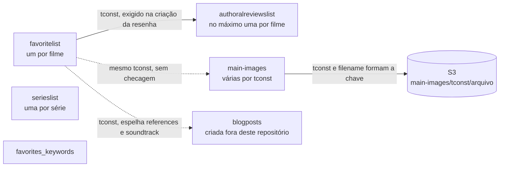

# Modelo de dados

O projeto guarda dados em dois lugares: no MongoDB Atlas (documentos) e no AWS S3 (arquivos de imagem). Este documento descreve os dois.

## MongoDB

O banco é o definido em `MONGODB_DATABASE`. Os nomes das coleções são constantes em `config.py`.

| Constante | Coleção | Módulo que escreve | Chave de negócio |
|---|---|---|---|
| `FAVORITES_COLLECTION` | `favoritelist` | `favorites` | `tconst` |
| `REVIEWS_COLLECTION` | `authoralreviewslist` | `write_review` | `tconst` |
| `SERIES_COLLECTION` | `serieslist` | `series` | `tconst` |
| `KEYWORDS_COLLECTION` | `favorites_keywords` | `keywords` | `keyword` |
| `MAIN_IMAGES_COLLECTION` | `main-images` | `main_images` | `tconst` + `filename` |
| `BLOGPOSTS_COLLECTION` | `blogposts` | nenhum cria; `favorites` atualiza | `tconst` |

Não há esquema declarado. O formato de cada documento é o que o controller grava. Os modelos Swagger em `routes.py` validam o corpo das requisições, e não os documentos.

### Índices

O código não cria nenhum índice (não há chamada a `create_index` no repositório). Se existem índices no Atlas além do `_id`, eles foram criados fora do código e não foram verificados.

A unicidade de `tconst` e de `keyword` é garantida só pela aplicação: cada controller faz um `find_one` antes do `insert_one`.

### O que é comum a todas as coleções

- `_id` é o `ObjectId` gerado pelo Mongo. `db.serialize` o converte para string em toda resposta.
- `db.serialize` troca `NaN` e infinito por `null`, em qualquer profundidade do documento.
- `db.update` usa `$set` só com os campos diferentes de `None`. Não existe remoção de campo pela API.
- A ordenação padrão de `db.search` é `_id` decrescente, ou seja, do mais recente para o mais antigo.

### `favoritelist`

Um documento por filme favorito. O texto é gravado em inglês, como o IMDB entrega. A versão em português fica em `translations.pt`.

| Campo | Tipo | Origem | Observações |
|---|---|---|---|
| `_id` | ObjectId | Mongo | |
| `tconst` | string | Caminho da rota | Chave de negócio. |
| `primaryTitle` | string | Scraper, `get_movie_title` | Sempre presente: sem título não há cadastro. |
| `imdb_url` | string | Montado: `https://www.imdb.com/title/<tconst>/` | |
| `created_at` | string ISO 8601 | `datetime.now().isoformat()` | Hora local do servidor, sem fuso. |
| `references` | lista de strings | Começa vazia; editável | |
| `backdrop_url` | string | GraphQL, `find_backdrop` | Preenchido no cadastro ou na primeira leitura. String vazia quando o IMDB não tem imagem adequada. |
| `title_pt` | string | GraphQL, `find_brazilian_title` | Preenchido no cadastro ou na primeira leitura. String vazia quando não há título brasileiro diferente do original. |
| `country` | string | Scraper, página principal | Primeiro país de origem listado. |
| `director` | string | Scraper, página principal | Primeiro nome da primeira seção de créditos. |
| `writers` | lista de strings | Scraper, página principal | Segunda seção de créditos. |
| `stars` | lista de strings | Scraper, página principal | Terceira seção de créditos. |
| `genres` | lista de strings | Scraper, página principal | |
| `plot` | string | Scraper, página principal | Sinopse curta. |
| `poster_url` | string | Scraper, página principal | |
| `startYear` | inteiro, ou string | Scraper, página principal | Inteiro quando o texto é numérico. Caso contrário o texto é gravado como veio. |
| `plot_keywords` | lista de strings | Scraper, página `keywords` | |
| `quote` | string | Scraper, página `quotes` | Primeira citação, no formato `Personagem : fala`. |
| `trivia` | string | Scraper, página `trivia` | Até cinco curiosidades, separadas por linha em branco. |
| `magnet_link` | string | RapidAPI; editável | |
| `subtitle_url` | string | OpenSubtitles | |
| `wiki` | string | Wikipedia; editável | URL da página em inglês. |
| `translations` | objeto | Argos Translate | `{"pt": {...}}` com os campos traduzidos entre `plot`, `trivia`, `quote`, `genres` e `plot_keywords`. |
| `soundtrack` | string | Só por edição | |
| `watched` | booleano | Só por edição | Não é gravado no cadastro. Fica ausente até a primeira edição. |

Observações:

- No cadastro, um campo coletado que volta `None` ou string vazia não é gravado. Por isso a maioria dos campos pode estar ausente.
- `backdrop_url` e `title_pt` são a exceção: na leitura, a ausência do campo dispara uma consulta ao IMDB, e o resultado é gravado, mesmo que seja string vazia.
- O campo `lang` que aparece nas respostas não existe no banco. Ele é acrescentado por `localize`.
- Os campos editáveis pela API são `magnet_link`, `references`, `soundtrack`, `watched` e `wiki`.

Exemplo de documento:

```json
{
  "_id": "ObjectId(665f1c2e9b1e8a0012345678)",
  "primaryTitle": "The 400 Blows",
  "tconst": "tt0053198",
  "imdb_url": "https://www.imdb.com/title/tt0053198/",
  "created_at": "2026-11-10T18:49:43.076953",
  "references": [],
  "country": "France",
  "director": "François Truffaut",
  "genres": ["Coming-of-Age", "Drama"],
  "plot": "A young boy, left without attention, delves into a life of petty crime.",
  "startYear": 1959,
  "title_pt": "Os Incompreendidos",
  "watched": true,
  "translations": {
    "pt": {
      "plot": "Um menino, deixado sem atenção, mergulha numa vida de pequenos crimes.",
      "genres": ["amadurecimento", "drama"]
    }
  }
}
```

### `authoralreviewslist`

Um documento por resenha. Há no máximo uma resenha por filme, regra aplicada pelo controller.

| Campo | Tipo | Origem | Observações |
|---|---|---|---|
| `_id` | ObjectId | Mongo | |
| `tconst` | string | Caminho da rota | Precisa existir em `favoritelist` no momento da criação. |
| `content` | objeto | Corpo da requisição | `{"pt": {"text": "..."}, "en": {"text": "..."}}`. `pt.text` é obrigatório na criação. Gravado como veio. |
| `created_at` | string ISO 8601 | `datetime.now().isoformat()` | |
| `isAiGenerated` | booleano | Corpo da requisição | `false` quando não vem. Não é editável. |
| `references` | lista de strings | Corpo da requisição | `[]` quando não vem. |
| `images` | lista de strings | Corpo da requisição | `[]` quando não vem. |
| `primaryTitle` | string | Copiado de `favoritelist` na criação | String vazia se o favorito não tem título. |

A ligação com o favorito é só o valor de `tconst`. Remover o favorito não remove a resenha.

### `serieslist`

Um documento por série. Todos os campos vêm da API GraphQL do IMDB no cadastro, exceto os quatro últimos da tabela.

| Campo | Tipo | Origem (campo na resposta do IMDB) | Observações |
|---|---|---|---|
| `_id` | ObjectId | Mongo | |
| `tconst` | string | `title.id` | |
| `primaryTitle` | string | `titleText.text` | Com os cabeçalhos padrão (país `US`, idioma `en-US`). |
| `originalTitle` | string | `originalTitleText.text` | |
| `startYear` | inteiro ou `null` | `releaseYear.year` | |
| `endYear` | inteiro ou `null` | `releaseYear.endYear` | `null` quando o IMDB não informa. |
| `plot` | string | `plot.plotText.plainText` | String vazia quando não há. |
| `genres` | lista de strings | `titleGenres.genres[].genre.text` | |
| `poster_url` | string | `primaryImage.url` | Com `._V1_.` trocado por `._V1_UX400_.`, para pedir a imagem com 400 px de largura. String vazia sem pôster. |
| `imdb_rating` | número ou `null` | `ratingsSummary.aggregateRating` | |
| `seasons` | inteiro | Tamanho de `episodes.seasons` | |
| `episodes` | inteiro | `episodes.episodes.total` | `0` quando não há. |
| `creators` | lista de strings | `principalCredits` da categoria `creator` | |
| `stars` | lista de strings | `principalCredits` da categoria `cast` | |
| `title_pt` | string | `find_brazilian_title` | String vazia quando não há título brasileiro diferente do original. |
| `imdb_url` | string | Montado: `https://www.imdb.com/title/<tconst>/` | |
| `watched` | booleano | `false` no cadastro; editável | Único campo editável. |
| `created_at` | string ISO 8601 | `datetime.now().isoformat()` | |

Os dados do IMDB são uma fotografia do momento do cadastro. Não há rota que os atualize.

### `favorites_keywords`

| Campo | Tipo | Origem | Observações |
|---|---|---|---|
| `_id` | ObjectId | Mongo | |
| `keyword` | string | Corpo da requisição | Sem espaços nas pontas. Comparação exata, com diferença entre maiúsculas e minúsculas. |

### `main-images`

Um documento por imagem enviada. É o índice do que existe no S3: a listagem de imagens lê só esta coleção.

| Campo | Tipo | Origem | Observações |
|---|---|---|---|
| `_id` | ObjectId | Mongo | Não aparece nas respostas. |
| `tconst` | string | Caminho da rota | Não é conferido contra `favoritelist`. |
| `filename` | string | `<sequential_id><extensão>` | Extensão do arquivo original em minúsculas. |
| `sequential_id` | inteiro | Maior valor existente para o `tconst`, mais 1 | Começa em 1. |
| `subtitle_en` | string | Campo do formulário | Texto original, sem a sanitização aplicada às tags. |
| `subtitle_pt` | string | Campo do formulário | Idem. |
| `created_at` | data do Mongo | `datetime.utcnow()` | UTC, como tipo de data. Nas outras coleções `created_at` é uma string em hora local. |

### `blogposts`

O backend não cria nem lê documentos desta coleção para responder a uma rota. O único uso é em `favorites.controller.sync_blogpost`: quando um favorito é editado com `references` ou `soundtrack`, e existe um documento com o mesmo `tconst` em `blogposts`, dois campos são atualizados.

| Campo no favorito | Campo gravado em `blogposts` |
|---|---|
| `references` | `references` |
| `soundtrack` | `spotify_album_url` |

Os demais campos da coleção e quem a cria não aparecem neste repositório (não verificado).

### Relações entre as coleções

Não há referências por `_id`. O que liga os documentos é o valor de `tconst`.



`serieslist` e `favorites_keywords` não se relacionam com as demais.

## AWS S3

O S3 guarda só os arquivos de imagem da funcionalidade [Imagens](funcionalidades/imagens.md). É o único serviço da AWS usado pelo projeto.

| Item | Valor |
|---|---|
| Bucket | `S3_BUCKET`, padrão `themoviesearch` |
| Região | `AWS_REGION`, padrão `us-east-2` |
| Chave do objeto | `main-images/<tconst>/<sequential_id><extensão>` |
| `Content-Type` | Definido pela extensão do arquivo original, com `mimetypes.types_map`. `application/octet-stream` para extensão desconhecida. |
| Conteúdo | A imagem depois de `optimize_image`: largura máxima de 800 px; JPEG com qualidade 85 ou PNG. |
| Tags do objeto | `subtitle_en` e `subtitle_pt`, gravadas só quando ao menos uma legenda foi enviada. |
| URL pública | `https://<bucket>.s3.<região>.amazonaws.com/main-images/<tconst>/<arquivo>` |

Sobre as tags:

- Os valores passam por `sanitize_tag_value`, que remove os caracteres fora de letras, números, sublinhado, espaço e hífen, e limita o texto a 256 caracteres.
- A legenda completa e sem alteração fica no Mongo. As respostas da API usam a do Mongo. O código nunca lê as tags de volta.

Sobre o acesso:

- O envio não define ACL. A URL pública só funciona se o bucket permitir leitura pública dos objetos. A política do bucket não está no repositório (não verificado).
- As operações usadas são `upload_fileobj`, `put_object_tagging` e `delete_object`. O código não lista nem lê objetos.

### Consistência entre o S3 e o Mongo

As duas gravações não são atômicas. Os casos possíveis, pela ordem das operações no código:

| Operação | Ordem | Se a segunda etapa falha |
|---|---|---|
| Envio | S3 (objeto e tags), depois Mongo | O objeto fica no S3 sem documento. Não aparece na listagem. |
| Remoção | S3, depois Mongo | Se o S3 falha com `ClientError`, nada é removido. Se o S3 funciona e o Mongo falha, o documento fica e a listagem aponta para um objeto que não existe mais. |
